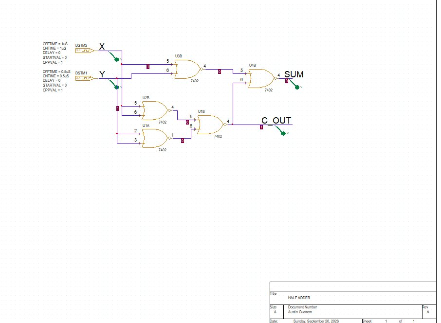
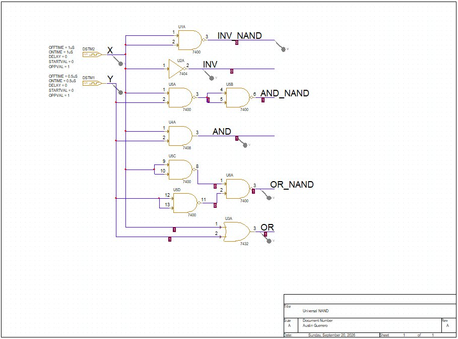
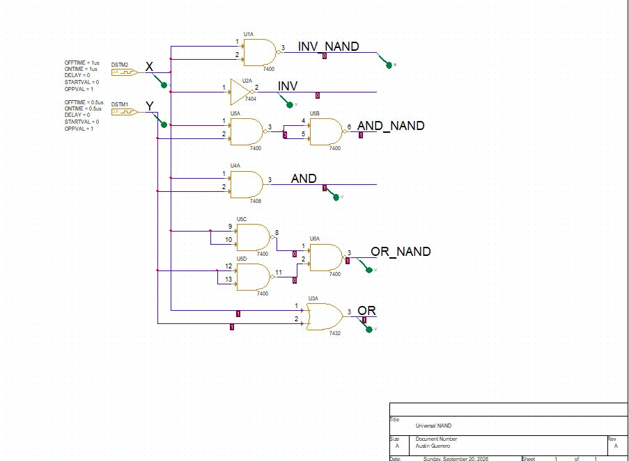
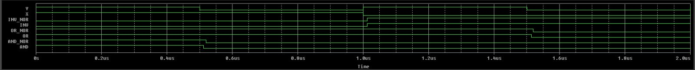
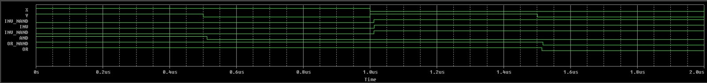

# Universal Gates and NOR-Only Half Adder
**ECE 221 Digital Logic Design · Design Project 1 · Valparaiso University · Fall 2026**

> **Key result:** A complete half adder built from only two-input NOR gates

Proved that NAND and NOR are universal gates, then designed a half adder using only two-input NOR gates.

## What I did

- Rebuilt NOT, AND, and OR from NAND gates alone and from NOR gates alone in OrCAD Capture.
- Verified each equivalent circuit against the standard gate with PSpice timing simulations.
- Designed a NOR-only half adder (SUM and C_OUT) and confirmed all four input cases in simulation.

## Report
- 📄 [Full report (PDF)](Guerrero_ECE221_DP1_Universal_Gates_Half_Adder.pdf)

## Figures

### Schematic: NOR-only half adder schematic (OrCAD Capture)

### Schematic: NOT, AND and OR rebuilt from NOR gates only

### Schematic: NOT, AND and OR rebuilt from NAND gates only

### Waveform: PSpice timing diagram of the NOR-gate equivalents

### Waveform: PSpice timing diagram of the NAND-gate equivalents

## Tools
OrCAD Capture, PSpice, Boolean algebra

---

**Austin Guerrero** · Electrical Engineering, Valparaiso University (Christ Honors College)  
Portfolio: [austinguerrero.dev](https://austinguerrero.dev) · LinkedIn: [in/guerrero-austin](https://www.linkedin.com/in/guerrero-austin)
